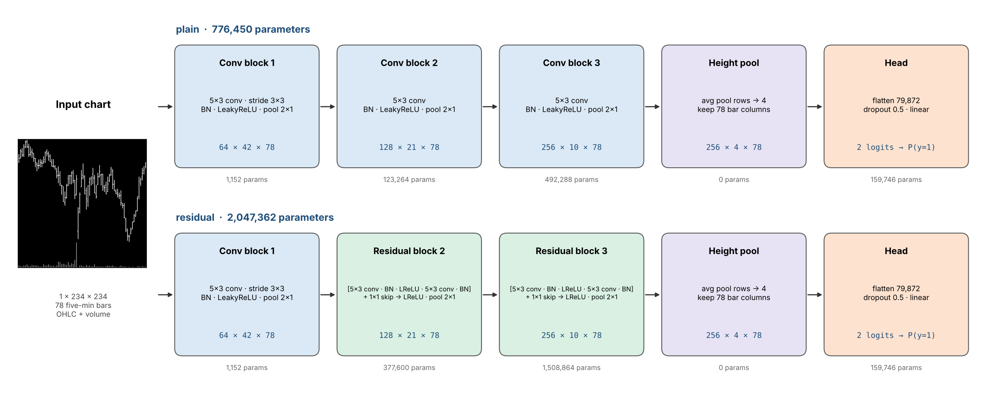

# CNN-Relevant

Chart-image CNN for 5-minute US equity bars (Jiang–Kelly–Xiu style), a ResNet-style variant, and a 1D CNN on the raw OHLCV numbers to test whether the image itself helps.

## Run (Google Colab)

1. Drive layout:
   - `Colab Notebooks/EC/Project/Demo/cnn78u_colab_bundle.zip` (data)
   - `Colab Notebooks/EC/Project/Demo/CNN-Relevant/` (this folder: notebook + `chartcnn/`)
2. Open `ChartCNN_Baseline.ipynb`, select a GPU runtime, **Run all**.
3. Outputs go to `Demo/CNN-Relevant/runs/<RUN_ID>/` (per run `<experiment>_<arch>/`, plus `analysis.csv`, `analysis.png`, `takeaways.md`).

## Targets and price basis

| experiment | label | stride |
|---|---|---|
| `vol_h1` | next bar's \|return\| above the stock's training median \|return\| | 6 |
| `dir_h1` | next bar's return strictly positive (zero returns dropped) | 6 |
| `xsdir_h12` | return over the next 12 bars above the cross-sectional median at that bar | 12 |
| `dir_h12` | return over the next 12 bars strictly positive (zero returns dropped) | 12 |

`dir_*` is the absolute direction, so it can be compared directly with the relative `xsdir_h12`.
Strides follow the frame-correlation results: label autocorrelation is near 0 by lag 12 for
12-bar labels. Every input window is adjusted to its own last bar (point in time), so no later
split or dividend reaches the chart; see `DATA_PIPELINE.md`.

## Layout

| Path | Content |
|---|---|
| `ChartCNN_Baseline.ipynb` | Main notebook: setup → models → frame correlation → train → results → analysis → test (off) |
| `chartcnn/data.py` | Labels (`vol`, `xs_dir`, `dir`), stride thinning, on-the-fly chart dataset |
| `chartcnn/images.py` | OHLCV window → 234×234 chart |
| `chartcnn/models.py` | `ChartCNN(arch="plain" \| "residual")`, `parameter_table` |
| `chartcnn/baselines.py` | Training prior, simple rules, HistGradientBoosting on hand features |
| `chartcnn/training.py` | Training loop, early stopping, resume, experiment runner, one-shot test |
| `chartcnn/evaluation.py` | AUC, log loss vs prior, decile long-short |
| `chartcnn/analysis.py` | Post-run analysis: plain vs residual, CNN vs baselines (day-bootstrap CIs), calibration, long-short, auto takeaways |
| `chartcnn/grid.py` | Horizon × target grid used by `../Multi-Target Chart CNN Baseline/` (resumable cells, AUC-by-horizon analysis) |
| `chartcnn/frame_corr.py` | Frame (image) / label / prediction correlation by lag, ICC, effective sample size |
| `results/frame_corr/` | Frame-correlation results on April 2023 validation data |
| `diagnostics/` | Signal-ceiling checks with hand features (`ceiling.py`, `horizons.py`) |
| `previous/` | Earlier single-file notebook (`CNN_Paper_Style_Targets.ipynb`) |
| `tools/` | Scripts that regenerate the diagram and the notebook |

## Models

| arch | blocks 2–3 | parameters |
|---|---|---|
| `plain` | Conv 5×3 → BN → LeakyReLU → MaxPool 2×1 | 776,450 |
| `residual` | [Conv → BN → LReLU → Conv → BN] + 1×1 skip → LReLU → MaxPool 2×1 | 2,047,362 |
| `series1d` | No image: the same 78-bar window as a (5, 78) OHLCV sequence, scaled like the chart; 3 × [Conv1d k=5 → BN → LeakyReLU] (128/256/384 channels) → Linear | 720,770 |

## Notebooks

| file | what it is |
|---|---|
| `ChartCNN_Baseline.ipynb` | The notebook exactly as executed on Colab for `run_20261114_020923`, with all outputs (same file as on Drive). |
| `ChartCNN_Baseline_dir_targets.ipynb` | Next version, not run yet: adds `dir_h1` / `dir_h12` and point-in-time windows. Upload it to Drive as `ChartCNN_Baseline.ipynb` for the next run. |

`tools/make_notebook.py` regenerates the unexecuted notebook; write it to `ChartCNN_Baseline_dir_targets.ipynb`
so the executed one is not overwritten.

## Results: run `run_20261114_020923` (Colab GPU, before `dir_*` was added)

Data: 2023 H1 bundle, train to 2023-03-31, validate on April 2023 (test not evaluated).
Settings (`results/run_20261114_020923/settings.json`): Adam lr 1e-5, weight decay 0, batch 128,
up to 12 epochs with patience 2, dropout 0.5, stride 6 (`vol_h1`) and 12 (`xsdir_h12`), seed 69.
AUC intervals are 95% day-bootstrap. Log-loss gain is relative to the training prior.
Decile long-short is top minus bottom decile, gross, bps per 12 bars, over 19 validation days.

| target | model | parameters | val AUC [95% CI] | log loss vs prior | long-short bps |
|---|---|---|---|---|---|
| `vol_h1` | CNN (plain) | 776,450 | 0.687 [0.676, 0.698] | +11.4% | |
| `vol_h1` | CNN (residual) | 2,047,362 | 0.685 [0.673, 0.697] | +9.8% | |
| `vol_h1` | CNN (series1d) | 720,770 | 0.690 [0.678, 0.703] | +10.4% | |
| `vol_h1` | HGB hand features | 18,300 tree nodes | 0.705 [0.692, 0.717] | +12.1% | |
| `vol_h1` | rule: recent abs return | 0 | 0.610 [0.601, 0.617] | | |
| `xsdir_h12` | CNN (plain) | 776,450 | 0.508 [0.502, 0.514] | -0.2% | -0.34 (t = -0.20) |
| `xsdir_h12` | CNN (residual) | 2,047,362 | 0.499 [0.491, 0.507] | -0.5% | +1.26 (t = 0.56) |
| `xsdir_h12` | CNN (series1d) | 720,770 | 0.495 [0.483, 0.507] | -0.6% | -0.51 (t = -0.19) |
| `xsdir_h12` | HGB hand features | 14,762 tree nodes | 0.503 [0.493, 0.513] | -0.4% | +1.93 (t = 0.55) |
| `xsdir_h12` | rule: 78-bar momentum | 0 | 0.492 [0.476, 0.513] | | |

Takeaways (paired day-bootstrap differences, from `takeaways.md`):

- **`vol_h1` is learnable, but the picture adds nothing.** Plain vs 1D CNN on raw OHLCV:
  -0.003 [-0.008, +0.001]. Residual vs plain: -0.002 [-0.005, +0.001], with 2.6× the parameters.
  HGB on 20 hand features beats the best CNN by 0.017 [0.012, 0.022].
- **`xsdir_h12` has no usable signal.** The plain CNN's AUC of 0.508 is just above 0.5 and ties HGB,
  log loss is worse than the prior, and the decile spread is not significant (|t| < 2).
- CNN probabilities on `vol_h1` are shifted up by about 0.05 against validation outcomes
  (calibration drift between March and April).

Files in `results/run_20261114_020923/`: `analysis.csv`, `analysis.png`, `takeaways.md`,
`settings.json`, and per `<target>_<arch>/` the training `history.csv`, `summary.json`,
`validation_comparison.csv` and `validation_deciles.csv`.

Not in git (stay on Drive, in `Colab Notebooks/EC/Project/Demo/CNN-Relevant/runs/run_20261114_020923/`):
checkpoints (`best.pt`, `last.pt`), validation predictions and `results.zip` (about 107 MB).
