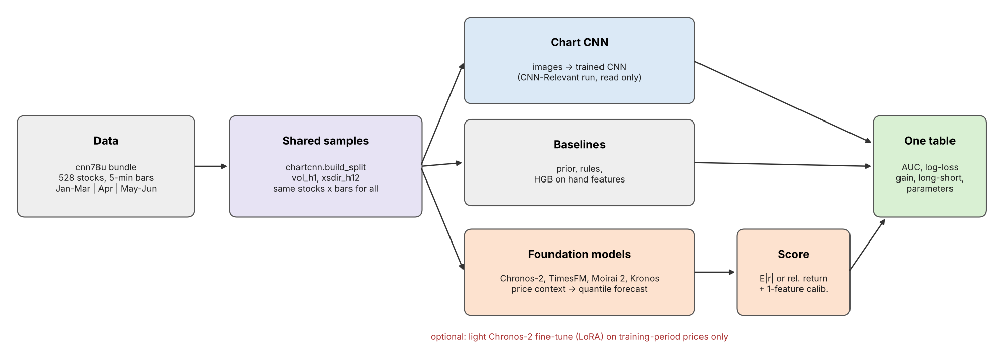

# Pretrained Model Comparison

Zero-shot (and lightly fine-tuned) time-series foundation models vs the chart CNN on the same
5-minute data, splits and targets as `CNN-Relevant/ChartCNN_Baseline.ipynb`.



## Run (Google Colab)

1. Drive layout (`Colab Notebooks/EC/Project/Demo/`):
   - `cnn78u_colab_bundle.zip` (data, already there)
   - `CNN-Relevant/chartcnn/` (shared data/eval code, already there)
   - `Pretrained Model Comparison/` (this folder: notebook + `tsfm_compare/`)
2. Optional but recommended: run `CNN-Relevant/ChartCNN_Baseline.ipynb` first. The newest run in
   `CNN-Relevant/runs/` is picked up automatically and added to the table.
3. Open `Pretrained_Model_Comparison.ipynb`, choose a GPU runtime, **Run all**.
4. Results: `Pretrained Model Comparison/runs/<RUN_ID>/comparison.csv`, `comparison.png`, `results.zip`.
   After a disconnect, set `RESUME_RUN_ID` in section 3 and run all again; finished forecasts are reused.

## Models

| name | Hugging Face id | input | notes |
|---|---|---|---|
| Chronos-2 | `amazon/chronos-2` | close | also light LoRA fine-tune (section 6) |
| Chronos-Bolt base | `amazon/chronos-bolt-base` | close | |
| TimesFM 3.0 | `google/timesfm-3.0-pytorch` | close | non-commercial weights; falls back to 2.5 (Apache-2.0) |
| Moirai 2.0 small | `Salesforce/moirai-2.0-R-small` | close | installed with `--no-deps` |
| Kronos small | `NeoQuasar/Kronos-small` | OHLCV candles + timestamps | cloned from GitHub; 8 sampled paths |

Each model prints its total parameter count when loaded, and the table has a `parameters` column.

## How a forecast becomes a score

- Input: the last 78 closes (the same day the CNN sees as a chart), divided by the last close.
- Output: 12-step quantile forecast (10 %, 20 %, …, 90 %).
- `vol_h1`: expected |return| of the next bar = mean over quantiles of |q − 1|, divided by the
  stock's training median |return| (the label threshold).
- `xsdir_h12`: median forecast return over 12 bars minus its cross-sectional median at that bar.
- AUC uses the raw score (pure zero-shot). For log loss, a 1-feature logistic regression is fitted
  on a training-period calibration sample and applied unchanged to validation.

## Layout

| Path | Content |
|---|---|
| `Pretrained_Model_Comparison.ipynb` | install → setup → config → samples → models → fine-tune → baselines/CNN → table → save |
| `tsfm_compare/samples.py` | Shared samples (via `chartcnn.build_split`), timestamp subsampling, model inputs |
| `tsfm_compare/forecasters.py` | One wrapper per model: load, parameter count, quantile forecast, Chronos-2 fine-tune |
| `tsfm_compare/scoring.py` | Forecast → score, calibration, baseline and CNN rows, comparison table |
| `tsfm_compare/runner.py` | Runs a model with forecast caching (Drive) |
| `tsfm_compare/plots.py` | AUC bar chart, forecast examples |
| `tools/` | Regenerate `assets/flow.png` and the notebook |

## Rebuild

```bash
python "Pretrained Model Comparison/tools/make_diagram.py"
python "Pretrained Model Comparison/tools/make_notebook.py"
```

The notebook was executed end to end on CPU with tiny random-weight models saved in each
library's own checkpoint format (Hugging Face downloads are blocked in that sandbox), on the real
bundle. That checks the code paths and shapes, not any accuracy. The first real numbers come from
the Colab run.
